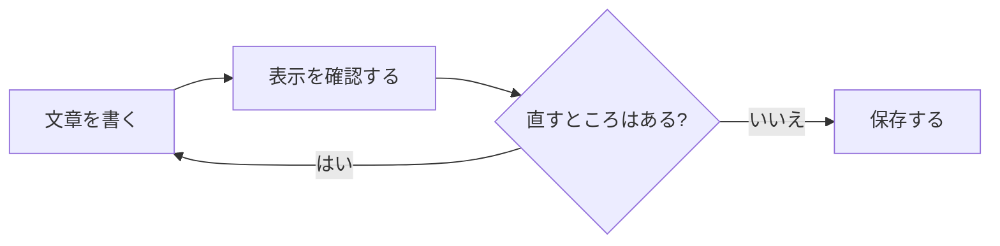
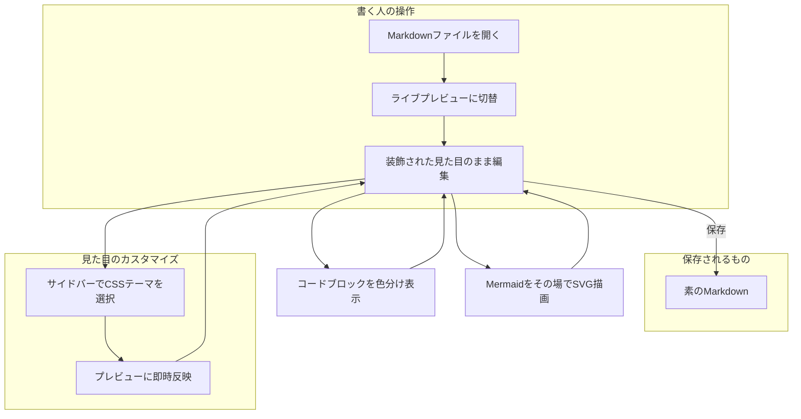
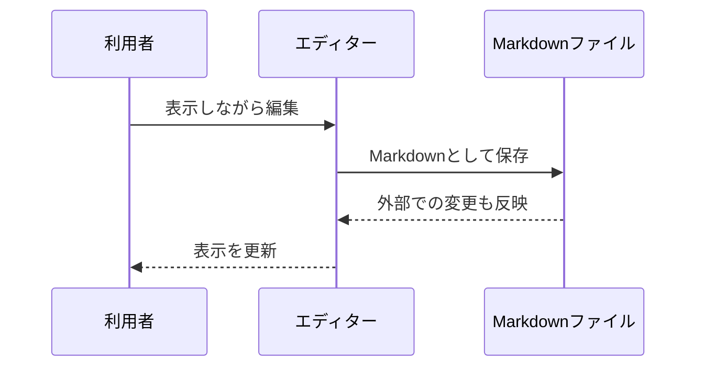

# Markdown Live Preview Editor

**書いた見た目のまま**編集できる、Markdownのライブプレビュー拡張機能です。

このファイルを「Markdown Live Preview」で開いてください。太字や斜体などは、カーソルが記号や文字に触れたときに元の記法が見えます。表・図・先頭の設定情報は、`</>` ボタンで元の記法を開きます。

表示できる記法と、操作して試す機能をまとめています。編集を試すときは、このファイルをコピーして使ってください。

## 確認のしかた

各見出しへはサイドバーの「Outline」から移動できます。色や背景は、明るいテーマと暗いテーマの両方で確認してください。

| 確認するもの | 操作と期待する結果 |
| --- | --- |
| 差分の色分け | 「差分の色分け」で追加行は緑、削除行は赤になる |
| 普通のコード | 「コード例」で文字が色分けされる。右上のコピーで内容をコピーできる |
| 表の編集 | セルをクリックして編集する。Tabで移動、Enterで確定、Escで取り消す |
| 表の行・列の追加 | 表の下端・右端の細い領域から追加できる |
| 図と設定情報 | フロントマターをクリックして展開する。`</>`で元の記法を開き、表示へ戻すボタンで戻る |
| 図の拡大 | 図をドラッグして移動する。ツールバーで拡大・縮小・表示のリセットができる |
| 検索・置換 | Ctrl+Fで「検索テスト」を探す。置換欄で文字を変更できる |
| 見出しの折りたたみ | 見出し左の三角で本文をたたむ。見出し末尾の「…」で開く。下位の見出しもまとめてたためる |
| 太字・斜体 | 文字を選択してCtrl+B／Ctrl+Iを押すと切り替わる |
| 複数カーソル | 「検索テスト」を選んでCtrl+Dを押すと次の同じ文字も選択される |
| 画像とリンク | 下のローカル画像が表示され、別サンプルへのリンクが開く |
| CSSテーマ | サイドバーの「CSS Themes」で切り替えると見た目が変わる |
| 入力の補助 | 後半の練習欄で、見出しの空白や記号の自動補完を試す |
| 保存・元に戻す | Ctrl+Sで保存、Ctrl+Zで取り消し、Ctrl+Shift+Zでやり直す |
| draw.ioの複数ページ | 「draw.ioとファイルへのリンク」で2ページの図を切り替える |
| 表示と設定 | 文書の末尾で、自動で開く設定や表示言語の説明を見る |

編集を試した後は、Ctrl+Zで元に戻せます。

## なぜObsidianライクなのか

VS Code標準のMarkdownプレビューは、編集用のペインとプレビュー用のペインが左右に分かれています。この拡張機能はその2つを1つにまとめ、*プレビューそのものを直接編集*できるようにします。

> 保存されるファイルの中身は、常に素のMarkdownです。
> 特殊な独自フォーマットに変換されることはありません。

## 主な機能

- ライブプレビュー編集(このドキュメントもその場で編集できます)
- シンタックスハイライト付きコードブロック
- Mermaidダイアグラムのその場描画
- サイドバーから切り替えられるCSSテーマ
- セルをその場で編集できる表
- draw.ioの図、AWSの図形、複数ページの表示
- 折りたためるフロントマター、画像の貼り付け、ファイルへのリンク
- 検索・置換、複数カーソル、文字装飾と入力の補助
- ~~生のMarkdownソースだけを見ながら書くつらさ~~ ← これとはもうお別れ

### 導入手順

1. VS Codeの拡張機能ビューで検索してインストールする
2. `.md`ファイルを開き、タイトルバーの切替アイコンをクリックする
3. プレビュー上で直接編集を始める

### 進捗メモ

- [x] プレビューをそのまま編集できるようにする
- [x] コードブロックを色分け表示する
- [x] 表のセルをその場で編集する
- [x] 差分の追加行・削除行を色分けする
- [ ] このサンプルの表示を目で確認する

## コード例

`inline code`だけでなく、フェンス付きのコードブロックも言語ごとに色分けされます。

コードブロック上部の左側に、`python`や`html`などの言語名が表示されます。指定がない場合は`text`です。ヘッダーの言語名や余白をクリックしても編集は始まりません。言語名を変えるときは、右側の`</>`ボタンで元の記法を開いてください。

```python
def toggle_live_preview(path: str) -> None:
    """.md を開いたときに、装飾されたプレビューへ自動で切り替える"""
    print(f"{path} をライブプレビューで開きました")
```

## 差分の色分け

`diff` と書いたコードブロックです。差分は計算せず、書かれた記号に応じて色を付けます。

```diff
--- a/greeting.ts
+++ b/greeting.ts
@@ -1,3 +1,3 @@
 const name = 'Markdown';
-console.log('Hello');
+console.log(`Hello, ${name}!`);
 console.log('変更していない行');
```

確認ポイント：`-console.log` は赤、`+console.log` は緑です。`@@` は青で、ファイル名の `---` と `+++` は太字です。変更していない行には追加・削除の色が付きません。

### 短い差分と空行

```diff
-古い説明
+新しい説明

 そのままの説明
```

### 普通のコードとの比較

言語を指定していないブロックの `+` と `-` には、差分の色が付きません。

```
+これは普通のコード
-これも普通のコード
```

## 仕組み



図にマウスを重ねると、操作のボタンが表示されます。表示モードのボタンで「画面に収める」と「実際の大きさ」を切り替えられます。実際の大きさの表示では、ドラッグで表示位置を動かせます。`Ctrl`+ホイールまたはツールバーの+/-で拡大・縮小できます。`↺`で画面に収まる表示に戻ります。`</>`で元の記法を開き、表示へ戻すボタンで図に戻れます。



## 見た目のカスタマイズ

サイドバーの「CSS Themes」から、プレビューの見た目を変えるスタイルを切り替えられます。

テーマを有効・無効にすると、この文書の文字や余白、色が変わります。詳しい操作は末尾の「テーマ管理と設定」で試せます。

もっと詳しく知りたい方は[GitHubリポジトリ](https://github.com/t-shoot/md-live-preview-editor)もご覧ください。

---

## 動作確認用サンプル

このセクションは、対応している記法を一通り目視確認するためのものです。

### 見出しレベル(h1〜h6)

#### 見出しレベル4

##### 見出しレベル5

###### 見出しレベル6

### 空白セルを含むテーブル

一部のセルが空でも、列がずれずに元の位置のまま表示されることを確認してください。

| 名前 | 備考 | 状態 |
| --- | --- | --- |
| Alice |  | OK |
|  | 保留 | NG |
| Bob | 完了 |  |

### 表の配置と文字装飾

| 左寄せ | 中央寄せ | 右寄せ |
| :--- | :---: | ---: |
| **太字** | *斜体* | 100 |
| `コード` | ~~取り消し~~ | 200 |
| パイプの表示：a\|b | [別サンプル](table-complex.md) | 300 |

セルを編集してEnterで確定してください。別のセルは元の内容のまま残ります。`</>`から元の記法を開き、表示へ戻す操作も試せます。

セルを選択して矢印キーを押すと、上下左右のセルへ移動できます。入力した文字は移動前に確定します。表の端では止まります。Shift＋矢印は、セル内の文字を選択する操作です。

`Shift+Tab`は前のセルへの移動です。別のセルをクリックしても変更を確定できます。セルを編集していない状態なら、表の文字をドラッグして選択・コピーできます。行や列の削除、並べ替え、配置の変更は、`</>`から元の記法を編集してください。

### 文字装飾・検索・複数カーソル

**太字のサンプル**、*斜体のサンプル*、~~取り消し線のサンプル~~、`インラインコード`。

検索テスト：最初の文字です。

検索テスト：次の文字です。

検索テスト：最後の文字です。

「検索テスト」を検索してEnter／F3で順番に移動してください。Escで検索欄を閉じます。文字を選択してCtrl+Dを押す操作も試してください。

### ローカル画像・画像の貼り付け


この画像はサンプルに同梱しています。インターネットにつながっていなくても表示できます。

画像の元の記法を編集できるか確認してください。画像をコピーして貼り付けるか、画像ファイルをドラッグすると、`assets/`に保存され、画像へのリンクが挿入されます。

画像のパスをドラッグして選択することもできます。画像を一度に複数渡した場合は、最初の1枚を取り込みます。

画像の貼り付け練習欄：ここをクリックし、スクリーンショットなどをCtrl+Vで貼り付けてください。

### draw.ioとファイルへのリンク


図にマウスを乗せて、元の記法への切り替えと拡大・縮小を試してください。

1ページ目はAWSのEC2の図形、2ページ目は基本図形の例です。図のツールバーの`‹`と`›`でページを切り替えてください。ページ表示が`1/2`、`2/2`と変わります。ページ表示にマウスを重ねると、ページ名が分かります。

- [draw.ioの詳しいサンプル](drawio-sample.md)
- [複雑な表のサンプル](table-complex.md)
- [draw.ioの元ファイル](showcase.drawio)
- [画像の元ファイル](showcase-image.svg)

リンクは、普通にクリックすると開きます。Webページはブラウザーへ、同じフォルダーのファイルはエディターへ渡されます。

### 箇条書き直下のテーブル(空行なし)

リスト項目の説明文に続けて、空行を挟まずインデントしたテーブルを書いた場合でも、表としてレンダリングされることを確認してください。

- 重みづけ(初期値。後から調整できる設計にする):
  | 行動 | 経験値 |
  |---|---|
  | 配達1個 | 1pt |
  | 集荷1個 | 1pt |
  | 訪問1件 | 5pt |
  | 良い感触1件 | 20pt |

## 対応フォーマット早見表

| 記法 | 表示 |
| --- | --- |
| 見出し | `#`〜`######` |
| 強調 | `**太字**` / `*斜体*` |
| リスト | 箇条書き・番号付き・タスク |
| コード | インライン・フェンス付き(色分け) |
| 差分 | `diff`ブロックの追加行は緑、削除行は赤 |
| 表 | セル編集、行・列の追加、元の記法への切り替え |
| 図 | Mermaid・draw.ioをその場で描画 |
| 設定情報 | ファイル先頭のYAMLを表示し、ボタンで元の記法へ切り替え |
| 画像 | ローカル画像の表示、貼り付け、ドラッグでの追加 |
| リンク | Webページ・同じフォルダーのファイルへの移動 |

## フロントマターを編集する

ファイル先頭の「フロントマター」をクリックすると、タイトル、公開状態、作成者、タグの一覧が開きます。もう一度押すと折りたためます。

`</>`でYAML（文書の設定を書く記法）を開き、タイトルを書き換えてください。表示へ戻すボタンで、変更した情報が表示されます。本文へカーソルを動かすだけでは表示形式は切り替わりません。

## リストと文字装飾を試す

別の書き方でも、__太字__と_斜体_を表示できます。**太字の中に *斜体* を入れる**こともできます。

- 箇条書きの親項目
  - 入れ子の項目
  - **太字**や`コード`も書けます

1. 番号付きの親項目
   1. 入れ子の番号付き項目
   2. 続きの項目
2. 次の親項目

- [x] チェック済みの項目
- [ ] クリックしてチェックを付ける
- [ ] もう一度クリックしてチェックを外す

チェックの変更は、元のMarkdownの`[ ]`と`[x]`に反映されます。箇条書きの先頭からドラッグしても、文字を選択してコピーできます。

## 検索条件・置換・複数カーソルを試す

Ctrl+Fで右上に1段の検索欄が開きます。左端の矢印で置換欄を開閉できます。

| 操作 | 試し方 |
| --- | --- |
| 次の一致へ | `↓`、Enter、またはF3 |
| 前の一致へ | `↑`、Shift+Enter、またはShift+F3 |
| 一致する文字をすべて選択 | 「すべて」を押す。英語表示では「all」 |
| 大文字・小文字を区別 | `Aa`を切り替え、下の「Sample」と「sample」を検索する |
| 単語単位で検索 | `│ab│`を切り替え、「cat」と「catalog」を検索する |
| 正規表現（文字のパターン） | `.*`を有効にし、`item-[0-9]+`で下の番号を探す |
| 1件ずつ置換 | 置換欄へ新しい文字を入れ、「置換」を押す |
| まとめて置換 | 「すべて置換」を押す。後でCtrl+Zで戻せる |
| 検索を閉じる | Esc、または右端の`×` |

Sample sample SAMPLE

cat catalog cat

item-001 item-002 item-123

装飾で隠れている記号も検索できます。リンクのURLの一部を検索すると、元の記法が開いて一致箇所が見えます。

次の「まとめて編集」を1つ選び、Ctrl+Dを繰り返してください。同じ文字が順番に選ばれ、複数箇所へまとめて入力できます。

まとめて編集：1つ目

まとめて編集：2つ目

まとめて編集：3つ目

文字を選択してCtrl+Bで太字、Ctrl+Iで斜体にできます。もう一度押すと解除できます。選択せず押すと、装飾の囲みを入れ、その中に入力できます。複数箇所を選択しているときも使えます。

## 入力の補助・保存・元に戻す

下の練習欄で試してください。記号を貼り付けず、キーボードで1文字ずつ入力します。

- 行頭で`#見出し`と入力すると、`# 見出し`の空白が補われます。
- 丸括弧、角括弧、波括弧、引用符を入力すると、閉じる記号が補われます。
- `*`と`_`も、文章を囲む記号として補われます。
- 文字を選択してバッククォート（コードを囲む記号）を入力すると、インラインコードで囲めます。
- 空の行頭でバッククォートを3つ入力すると、下に閉じる囲みが追加されます。
- 本文のTabは字下げに使えます。表の編集中はセル移動になります。

入力の練習欄：

この行の下で、見出しやコードの囲みを入力してください。

| 操作 | ショートカット |
| --- | --- |
| 元に戻す | Ctrl+Z |
| やり直す | Ctrl+Shift+Z、またはCtrl+Y |
| 保存する | Ctrl+S |

別のエディターなどで同じファイルを書き換えると、ライブプレビューにも反映されます。試すときは、先にこの画面の変更を保存してください。

## Mermaidの別の図と、直接書くdraw.io

Mermaidは、図のつながりを文章で書く記法です。作業の流れのほかに、やり取りの順番も表示できます。



draw.ioは、別ファイルを参照するほかに、`drawio`のコードブロックへXML（図の構造を表す文字）を直接書くこともできます。

```drawio
<mxGraphModel><root>
  <mxCell id="0"/>
  <mxCell id="1" parent="0"/>
  <mxCell id="web" value="Web" style="rounded=1;fillColor=#dae8fc;strokeColor=#6c8ebf;fontColor=#172554" vertex="1" parent="1">
    <mxGeometry x="20" y="20" width="140" height="60" as="geometry"/>
  </mxCell>
  <mxCell id="db" value="Database" style="shape=cylinder;fillColor=#d5e8d4;strokeColor=#82b366;fontColor=#14532d" vertex="1" parent="1">
    <mxGeometry x="250" y="10" width="140" height="80" as="geometry"/>
  </mxCell>
  <mxCell id="edge" edge="1" parent="1" source="web" target="db"><mxGeometry as="geometry"/></mxCell>
</root></mxGraphModel>
```

どちらの図も、マウスを重ねると操作ボタンが出ます。図そのものをクリックしても、勝手に元の記法へ切り替わりません。

## 対応する23言語のコード例

先ほどのPythonを含め、色分け用に用意されている23言語の例です。現在の環境では、C#とSwiftは色分けできず、文字だけで表示されます。

コード右上のコピーボタンでは、囲みの記号を含めずに内容をコピーできます。`</>`で言語名と囲みも編集できます。

JavaScript

```javascript
const greet = (name) => `Hello, ${name}!`;
```

TypeScript

```typescript
const greet = (name: string): string => `Hello, ${name}!`;
```

JSX

```jsx
const Welcome = () => <h1>Hello, Markdown!</h1>;
```

TSX

```tsx
const Welcome = ({ name }: { name: string }) => <h1>Hello, {name}!</h1>;
```

HTML

```html
<main><h1>Hello, Markdown!</h1></main>
```

CSS

```css
h1 { color: #2563eb; font-weight: bold; }
```

JSON

```json
{ "title": "Markdown", "enabled": true }
```

YAML

```yaml
title: Markdown
enabled: true
```

Markdown。外側を4つのバッククォートで囲むと、3つの記号も内容に書けます。

````markdown
# 見出し
**太字**と[リンク](https://example.com)
```text
内側のコード
```
````

Bash

```bash
name="Markdown"
printf 'Hello, %s!\n' "$name"
```

Shell script

```shellscript
for name in Markdown Preview; do echo "$name"; done
```

C

```c
#include <stdio.h>
int main(void) { puts("Hello, Markdown!"); return 0; }
```

C++

```cpp
#include <iostream>
int main() { std::cout << "Hello, Markdown!"; }
```

C#

```csharp
Console.WriteLine("Hello, Markdown!");
```

Java

```java
class Welcome {
    public static void main(String[] args) { System.out.println("Hello, Markdown!"); }
}
```

Go

```go
package main
import "fmt"
func main() { fmt.Println("Hello, Markdown!") }
```

Rust

```rust
fn main() { println!("Hello, Markdown!"); }
```

Ruby

```ruby
name = "Markdown"
puts "Hello, #{name}!"
```

PHP

```php
<?php
echo "Hello, Markdown!";
```

SQL

```sql
SELECT title, updated_at FROM documents WHERE published = true;
```

Kotlin

```kotlin
fun main() { println("Hello, Markdown!") }
```

Swift

```swift
let name = "Markdown"
print("Hello, \(name)!")
```

## テーマ管理と設定

### CSSテーマを作る・編集する

CSSは、文字や余白、色などの見た目を決める設定です。サイドバーの「CSS Themes」から操作できます。

1. テーマを有効・無効にし、この文書の見た目を比べます。複数のテーマを組み合わせることもできます。
2. `+`から新しいCSSテーマを作れます。
3. テーマの編集ボタンでCSSを開くと、隣に専用のプレビューが出ます。
4. CSSを書き換えると、専用プレビューへすぐに反映されます。
5. CSSを保存すると、開いているこの文書にも反映されます。
6. CSSのルールにカーソルを置くと、専用プレビューの対応する場所が光ります。
7. 複製、名前の変更、削除もできます。練習には複製したテーマを使ってください。

### コードの配色

`mdLivePreview.codeTheme`でコードの色を切り替えられます。

| 設定値 | 配色 |
| --- | --- |
| `auto` | Visual Studio Codeの明るい・暗いテーマに合わせる |
| `dark-plus` | Dark+ |
| `light-plus` | Light+ |
| `github-dark` | GitHubの暗い配色 |
| `github-light` | GitHubの明るい配色 |

### 開き方・見出し一覧・表示言語

- タイトルバーの切替アイコンで、ライブプレビューと普通の文字編集を切り替えられます。
- `.md`と`.markdown`のファイルを開けます。
- `mdLivePreview.defaultEditor`を`livePreview`にすると、自動でライブプレビューを開きます。
- `prompt`と`default`は、普通の文字編集から開きます。必要なときに切替アイコンを押してください。
- 「Outline」から見出しへ移動できます。見出しの追加や変更、文書タブの切替も反映されます。
- 操作欄は、Visual Studio Codeの表示言語に合わせて日本語・英語で切り替わります。
- 有効にしたCSSテーマは、再起動後も引き継がれます。

macOSでは、主なCtrlの操作を⌘に読み替えてください。図のホイール操作も⌘を使えます。
